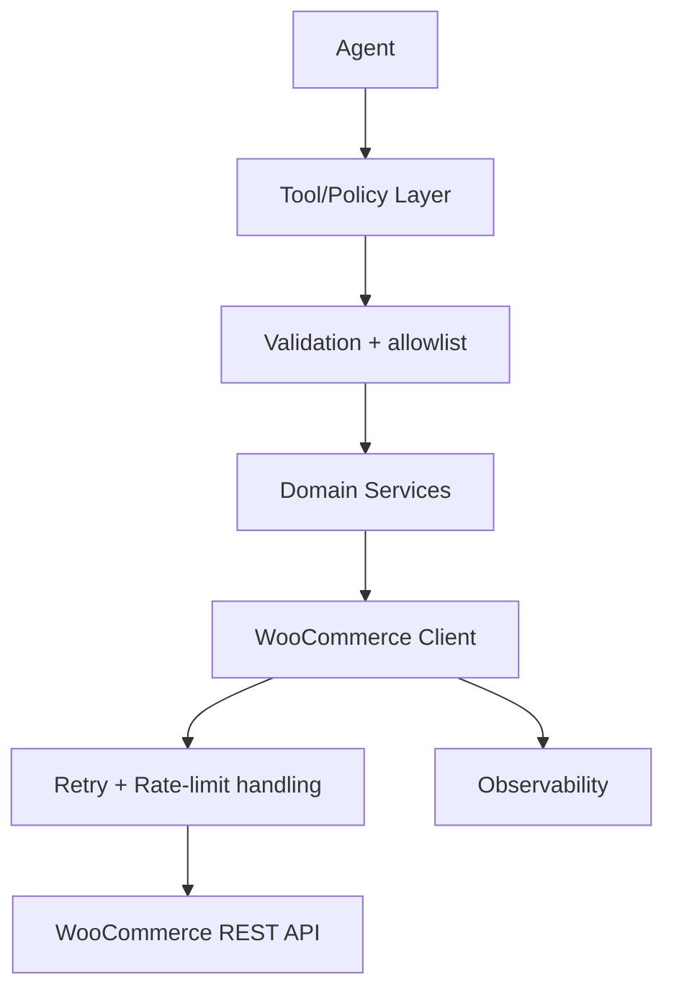

# WooCommerce Merchant Connector

A read-only, agent-ready connector for safely accessing WooCommerce orders, products, and inventory.

## 1. Problem

Merchants need a safe way for AI agents to answer operational questions without exposing arbitrary WooCommerce APIs or allowing mutation. Typical workflows include checking order status, reviewing recent orders, identifying low-stock products, and looking up catalog details without risking refunds, order changes, or inventory edits.

## 2. Architecture



## 3. Features

- API-key authentication
- read-only tools
- order search
- product search
- inventory
- pagination
- retries
- rate limits
- validation
- normalized outputs
- observability
- deterministic tests
- demo mode

## 4. Setup

```bash
npm install
cp .env.example .env
npm run demo
```

## 5. Configuration

Configuration comes from environment variables and is documented in `.env.example`.

```bash
WOOCOMMERCE_STORE_URL=https://example-store.com
WOOCOMMERCE_CONSUMER_KEY=replace_with_consumer_key
WOOCOMMERCE_CONSUMER_SECRET=replace_with_consumer_secret
DEMO_MODE=true
MAX_RETRIES=3
INITIAL_BACKOFF_MS=250
MAX_BACKOFF_MS=4000
REQUEST_TIMEOUT_MS=10000
MAX_AUTO_PAGES=5
```

## 6. Demo

```bash
npm run demo
```

## 7. Tool Catalog

| Tool | Purpose |
| --- | --- |
| `woo_list_orders` | Bounded order listing |
| `woo_get_order` | Fetch a known order by ID |
| `woo_search_orders` | Search orders by customer or status |
| `woo_list_products` | Bounded catalog listing |
| `woo_get_product` | Fetch a known product by ID |
| `woo_search_products` | Search products by SKU or name |
| `woo_get_inventory` | Check stock status for a product |

## 8. Security

Allowed behavior is limited to read-only access. The connector blocks arbitrary WooCommerce endpoints, mutations, refunds, payment changes, customer deletion, and bulk enumeration. See [SECURITY.md](SECURITY.md).

## 9. Testing

```bash
npm test
```

Expected behavior: deterministic, offline tests for auth, validation, pagination, retry logic, and tool contracts.

## 10. Architecture

The project separates concerns across config, client, services, tool registry, and observability. Production mode reads credentials from environment variables, while demo mode exercises the same interfaces with deterministic fictional data.

## 11. Limitations

This connector intentionally supports a narrow, read-only merchant workflow. See [LIMITATIONS.md](LIMITATIONS.md).

## 12. Production Deployment

In production, the connector should sit behind a policy layer with secret storage, audit logging, and operator approvals for any higher-privilege integration. The connector itself remains intentionally narrow and read-only.

## 13. Evaluation

See [EVALUATION.md](EVALUATION.md) for deterministic scenario testing and evaluation criteria.

---

## Repository Structure

```text
src/
  client/
  config/
  demo/
  errors/
  observability/
  schemas/
  security/
  services/
  tools/
  demo.ts
  index.ts
  verifyConnection.ts

tests/
  auth/
  client/
  security/
  services/
  tools/

README.md
SECURITY.md
TOOLS.md
EVALUATION.md
MERCHANT_WORKFLOWS.md
ADR.md
LIMITATIONS.md
.env.example
```
